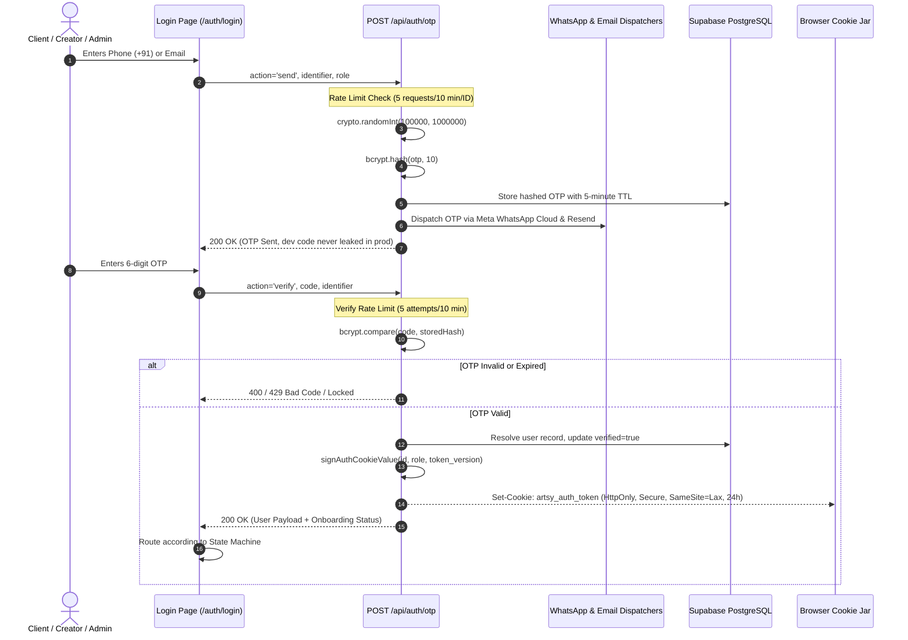
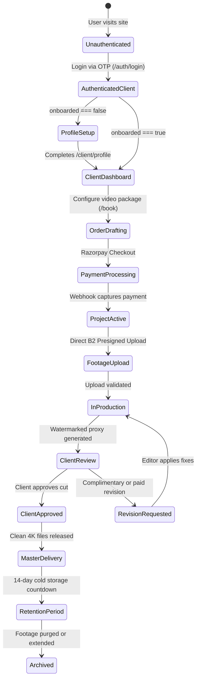
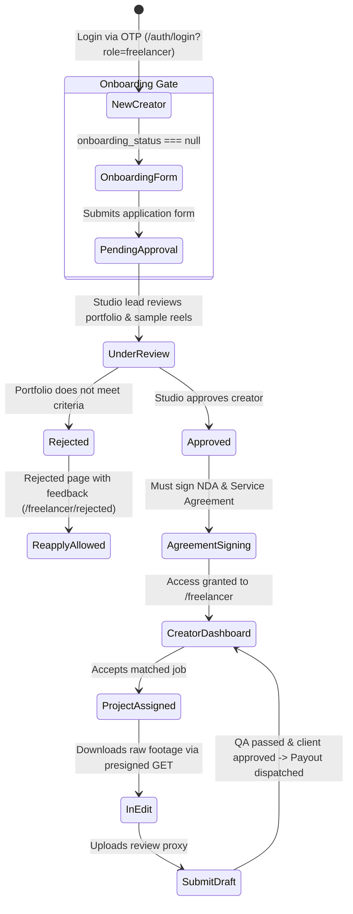
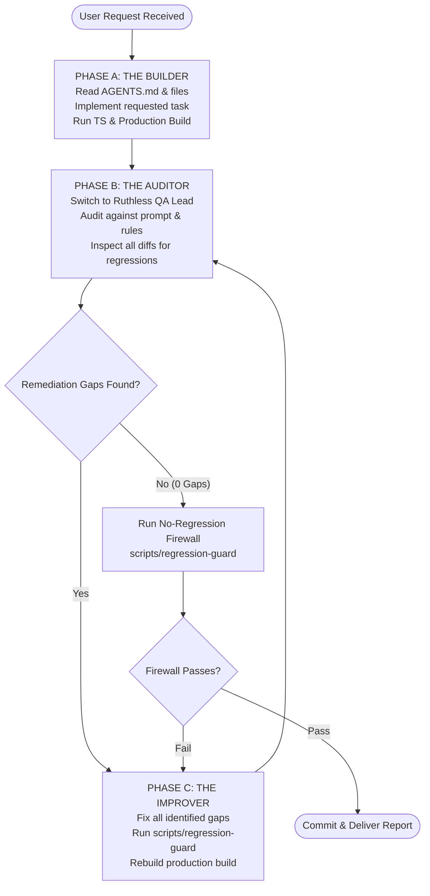

# ARTSY PRODUCTION — CANONICAL AGENTS MEMORY BANK & AUTONOMOUS SYSTEM
=============================================================================
**Document Version:** 3.0 (Master Plan v2.1 & Production Parity Locked)  
**Target Environment:** Node.js, Next.js App Router, Supabase PostgreSQL, Vercel Edge  
**Primary Source of Truth:** `AGENTS.md`  

> [!IMPORTANT]
> **MANDATORY DIRECTIVE FOR ALL FUTURE AI AGENTS:**
> You MUST read this document in its entirety before analyzing, modifying, or creating any code in this repository.
> Every engineering action must strictly uphold the state machines, zero-trust security invariants, financial formulas, and autonomous self-auditing loop defined below.

---

## 1. EXACT ARCHITECTURE & SYSTEM TOPOLOGY

Artsy Production operates an enterprise-grade video post-production platform connecting elite creative clients with vetted freelance editors and colorists under studio oversight.

### 1.1 Technical Stack & Infrastructure Components
| Layer | Technology | Configuration & Specifics |
| :--- | :--- | :--- |
| **Framework** | Next.js 16.4.0 (App Router) | React 19.2.8, Tailwind CSS v4, Webpack compiler (`next build --webpack`) |
| **Language Runtime** | Node.js v20+ / TypeScript 5 | Strict typing enabled (`noEmit: true`, `strict: true`) |
| **Database** | Supabase PostgreSQL | Hosted on AWS `ap-south-1` (Mumbai). TLS 1.3 enforced. |
| **RLS Mode** | Zero-Trust Server Lockdown | Public/anon access revoked across public schema. All mutations through server API routes with `service_role` and `x-artsy-server-auth` header. |
| **Edge Middleware** | Next.js Edge Middleware (`src/middleware.ts`) | Distributed IP rate limiting, CORS strict origin matching, payload size caps (2MB API, 10MB storage), route authorization. |
| **Payment Gateway** | Razorpay | Standard 2.0% gateway fee + 18% GST on fee. SHA256 HMAC webhook verification with 5-minute replay guard and unique idempotency keys. |
| **Raw File Storage** | Backblaze B2 (S3-compatible) | Bucket: `artsy-production-raw-footage`, Endpoint: `s3.us-west-004.backblazeb2.com`, Region: `us-west-004`. Direct browser PUT via 15-minute presigned URLs with mediainfo container validation. |
| **Review Video CDN** | Bunny Stream / Bunny CDN | Pull zones and stream endpoints: `video.bunnycdn.com`, `*.b-cdn.net`. HLS 1080p proxies with watermarking. |
| **Messaging & Notifications** | Meta WhatsApp Cloud API & Resend | WhatsApp HSM transactional templates (`graph.facebook.com/v23.0`) + transactional email dispatcher via Resend. |
| **PII Encryption** | Node `crypto` & PostgreSQL `pgcrypto` | AES-256-GCM authenticated encryption for sensitive banking and tax data (PAN, Bank Account, IFSC). |

### 1.2 Monorepo Directory Structure
```text
ARTSY WEB/
├── AGENTS.md                       # Canonical Memory Bank & Agent Rules (Root Source of Truth)
├── package.json                    # Root workspace package orchestrating artsy-next
├── scripts/
│   └── regression-guard            # Autonomous No-Regression Firewall static analyzer
└── artsy-next/                     # Core Next.js Application Root
    ├── next.config.ts              # Next.js configuration, security headers & CSP
    ├── package.json                # Application dependencies, scripts, and build targets
    ├── tsconfig.json               # TypeScript compiler configuration & path aliases (@/*, @/lib/*)
    ├── scripts/
    │   ├── regression-guard        # Mirrored firewall runner for subproject execution
    │   ├── test-e2e-suite.ts       # 20/20 End-to-End automated integration test suite
    │   ├── test-no-dev-bypass.sh   # Dev bypass regression test
    │   └── verify-rls-lockdown.mjs # RLS enforcement & anon rejection verification
    ├── supabase/
    │   └── migrations/             # Idempotent SQL migrations (000_canonical through 012_fix_rls)
    ├── lib/                        # Core shared modules (auth, supabase, auth-utils)
    └── src/
        ├── middleware.ts           # Global Edge Route Guard, Rate Limiter & Sanity Firewall
        ├── components/             # Reusable UI components (strictly client/server isolated)
        │   ├── RazorpayCheckoutButton.tsx
        │   ├── YouTubePlayerModal.tsx
        │   ├── LiteYouTubeEmbed.tsx
        │   ├── FontLoader.tsx
        │   └── [admin|booking|dashboard|freelancer|marketing|preview|project]/
        ├── lib/                    # Domain logic & engines
        │   ├── financial/engine.ts # Canonical GST, TDS, and 70/30 waterfall math
        │   ├── pricing/engine.ts   # Dynamic pricing calculator & quote generator
        │   ├── pricing/catalog-matrix.ts # Live catalog matrix & product specs
        │   ├── auth-cookie.ts      # Server-side HMAC cookie creation and verification
        │   ├── auth-cookie-edge.ts # Edge runtime Web Crypto HMAC parsing
        │   ├── crypto/pii.ts       # AES-256-GCM encryption & format masking
        │   ├── rateLimit.ts        # Upstash Redis & in-memory sliding window rate limiter
        │   ├── invoices/           # GST tax invoice generation & vault storage
        │   ├── storage/            # Backblaze B2 presigned ingest & header validator
        │   └── whatsapp/           # Meta Cloud API template dispatchers
        └── app/                    # Next.js App Router endpoints & page views
            ├── (client)/           # Client portal routes
            ├── admin/              # Studio Ops Administration Portal
            ├── freelancer/         # Creator workstation & application portal
            ├── api/                # Secure server-side REST API handlers
            └── auth/               # Unified authentication pages (login, verify)
```

---

## 2. AUTHENTICATION & SESSION STATE MACHINE

Authentication in Artsy Production is completely decoupled from vulnerable client-side magic links or raw third-party session tokens. It is powered by a proprietary, cryptographically signed HTTP-only HMAC session system.

### 2.1 The Authentication Flow


### 2.2 Token Structure & HMAC Signatures
1. **Cookie Format:** `<payloadBase64>.<signatureHex>`
2. **Payload Fields:**
   - `id`: Canonical UUID string of the user.
   - `role`: `'client' | 'freelancer' | 'admin' | 'super_admin'`.
   - `token_version`: Monotonically increasing integer (revocation guard, must be $\ge 2$).
   - `exp`: Epoch millisecond expiration timestamp (24-hour lifetime).
3. **Cryptographic Signing:**
   - Node Environment: `crypto.createHmac('sha256', secret).update(payloadBase64).digest('hex')`.
   - Edge Runtime: Web Crypto API `SubtleCrypto.sign('HMAC', key, data)`.
   - Constant-time verification prevents timing attacks (`crypto.timingSafeEqual` or bitwise XOR accumulator).
4. **Instant Revocation via `token_version`:**
   - Every user table row has a `token_version` integer column.
   - When a user logs out everywhere, changes credentials, or is terminated by an admin, `token_version` is incremented in PostgreSQL.
   - Any cookie bearing an older `token_version` is rejected immediately by `verifyAndParseAuthCookie`.

### 2.3 Strict Route Guard Invariants
- **Public Routes:** `/`, `/work`, `/services`, `/services/*`, `/pricing`, `/about`, `/contact`, `/book`, `/cookies`, `/terms`, `/privacy`, `/refund-policy`.  
  *Rule:* Must NEVER be blocked by route guards. Cross-portal navigation from public pages must NEVER strip or overwrite authenticated session cookies.
- **Admin Portal (`/admin/*`):**  
  *Rule:* Accessible ONLY to `role: 'admin'` or `role: 'super_admin'`. Unauthorized visits must be redirected to `/admin/login` or `/auth/login` WITHOUT clearing non-admin cookies.
- **Client Portal (`/client/*`, `/client-dashboard`):**  
  *Rule:* Accessible to `client`, `admin`, `super_admin`. If `client` has not completed profile setup (`onboarded === false`), all internal pages redirect to `/client/profile?setup=true`.
- **Creator Portal (`/freelancer/*`):**  
  *Rule:* Accessible to `freelancer`, `admin`, `super_admin`. Strict onboarding state machine applies (see Section 4).

### 2.4 Absolute Security Mandates
- **NO Hardcoded OTPs:** No `'123456'`, `"123456"`, `'4210'`, or default codes may exist anywhere in the codebase.
- **NO Mock Admin Logins:** Admin authentication requires authentic phone/email OTP verification matching privileged credentials.
- **Zero Client Database Queries:** React client components (`'use client'`) are strictly forbidden from importing `@supabase/supabase-js` or querying the database.

---

## 3. DATABASE SCHEMA, RLS & FINANCIAL MATH

### 3.1 Core Database Tables
| Table Name | Primary Key | Key Invariants & Purpose |
| :--- | :--- | :--- |
| `public.users` | `UUID` | Master user directory. Enforces unique email and phone. Contains `role`, `status`, `token_version`, and soft-delete marker `deleted_at`. |
| `public.creator_profiles` | `UUID (FK users.id)` | Freelancer vetting and talent profile. Contains AES-256 encrypted banking details, skills, software, portfolio links, and approval statuses. |
| `public.services` | `UUID` | Active services catalog across wedding, brand, corporate, and personal video production. Stores base prices in paise. |
| `public.pricing_rules` | `UUID` | Structured pricing rules for multi-cam, rush delivery, 4K rendering, and revisions. |
| `public.quotes` | `UUID` | Immutable snapshot of client order configurations with a strict 7-day validity limit. |
| `public.orders` | `UUID` | Primary commerce record. 14 lifecycle statuses. Tracks gross amount, GST, net amount, and Razorpay references. |
| `public.payments` | `UUID` | **WORM Immutable Table.** Captures gateway transaction receipts. Updates and deletes are blocked by PostgreSQL triggers. |
| `public.projects` | `UUID` | Production workstation lifecycle with a 32-status state machine. |
| `public.assignments` | `UUID` | Matches approved creators with active projects. |
| `public.file_records` | `UUID` | Ingested camera footage metadata, presigned B2 storage keys, and BunnyCDN video IDs. |
| `public.creator_payouts` | `UUID` | Creator compensation ledger. Tracks gross share, statutory TDS deductions, and NEFT payment states. |
| `public.credit_notes` | `UUID` | Append-only corrective ledger for refunds, price adjustments, and cancellations. |
| `public.audit_logs` | `UUID` | Append-only security audit trail recording all administrative disclosures, PAN reveals, and status alterations. |

### 3.2 Write-Once-Read-Many (WORM) Immutability Trigger
To guarantee financial integrity and regulatory compliance under Indian financial laws, `public.payments` is protected by trigger `trg_block_payments_update` and `trg_block_payments_delete`:
- Any `UPDATE` or `DELETE` attempt executed against `public.payments` immediately raises an exception with error code `23514` (`check_violation`).
- Corrections, refunds, or reversals must be written to `public.credit_notes` or `public.creator_payouts` as append-only events.

### 3.3 Zero-Trust Row Level Security (RLS) Policy
- All public tables have `ENABLE ROW LEVEL SECURITY` turned on.
- Direct table access permissions (`SELECT`, `INSERT`, `UPDATE`, `DELETE`) are **REVOKED** from `anon` and untrusted roles.
- Backend server operations utilize `service_role` paired with the internal authorization function `is_server_authorized()` checking header `x-artsy-server-auth`.

### 3.4 Exact Financial Waterfall & Statutory Math
All monetary transactions are calculated and stored as **PAISE** (integers, where $1\text{ INR} = 100\text{ paise}$) to eliminate floating-point rounding errors.

Given a client payment $P$ (e.g., ₹8,000 package = 800,000 paise):

$$\text{Pre-GST Revenue } (R) = \text{round}\left(\frac{P}{1 + \text{GST Rate}}\right) = \text{round}\left(\frac{800,000}{1.18}\right) = 677,966\text{ paise } (₹6,779.66)$$

$$\text{GST Liability } (G) = P - R = 800,000 - 677,966 = 122,034\text{ paise } (₹1,220.34)$$

$$\text{Gateway Fee } (F_{\text{gw}}) = \text{round}(P \times 0.02) = 16,000\text{ paise } (₹160.00)$$

$$\text{Gateway Fee GST } (G_{\text{gw}}) = \text{round}(F_{\text{gw}} \times 0.18) = 2,880\text{ paise } (₹28.80)$$

$$\text{Total Gateway Deduction } (D_{\text{gw}}) = F_{\text{gw}} + G_{\text{gw}} = 18,880\text{ paise } (₹188.80)$$

$$\text{Infrastructure Allocation } (I) = 11,500\text{ paise } (₹115.00 \text{ fixed allocation per project})$$

$$\text{Available for Split } (A) = R - D_{\text{gw}} - I = 677,966 - 18,880 - 11,500 = 647,586\text{ paise } (₹6,475.86)$$

$$\text{Creator Share } (70\%) = \text{round}(A \times 0.70) = 453,310\text{ paise } (₹4,533.10)$$

$$\text{Artsy Share } (30\%) = A - \text{Creator Share} = 647,586 - 453,310 = 194,276\text{ paise } (₹1,942.76)$$

$$\text{Statutory TDS Deduction } (2\% \text{ under Section 194J-Tech}) = \text{round}(\text{Creator Share} \times 0.02) = 9,066\text{ paise } (₹90.66)$$

$$\text{Creator Net Payout} = \text{Creator Share} - \text{TDS} = 453,310 - 9,066 = 444,244\text{ paise } (₹4,442.44)$$

---

## 4. WORKFLOW STATE MACHINES

### 4.1 Client Workflow State Machine


### 4.2 Creator (Freelancer) Workflow State Machine
A brand new creator MUST NEVER bypass the onboarding application form.



#### Creator Routing Invariants
1. If a creator visits `/freelancer/pending-approval` directly but has NOT submitted an application (`onboarding_status === null`), they MUST immediately be redirected to `/freelancer/onboarding`.
2. Initial OTP login for a new creator must NOT insert a premature pending profile row into `creator_profiles`. The profile row is created only upon valid form submission via `/api/freelancer/onboard`.
3. If approved, visiting `/freelancer/pending-approval` automatically redirects to `/freelancer`.
4. If rejected, visiting any workstation page redirects to `/freelancer/rejected`.

---

## 5. DYNAMIC PRICING ENGINE

### 5.1 Architecture & Principles
- **Server-Side Authoritative:** All order prices are computed strictly on the backend via `src/lib/pricing/engine.ts`. Any client-supplied price or amount parameter in API payloads is discarded and logged as a potential tampering attempt.
- **Fail-Closed on Unrecognized Services:** If a client requests a service, category, or subcategory that does not match the canonical matrix (`src/lib/pricing/catalog-matrix.ts`) or rules, the engine MUST throw an error (`throw new Error('Unable to calculate price for this configuration')`), and the API endpoint MUST return an HTTP 400 Bad Request.
- **NEVER Fallback to a Silent Default:** Under no circumstances may an unrecognized product silently default to ₹6,000 or any arbitrary constant.

### 5.2 Dynamic Adjustments Model
Base price is determined by the selected service package, then adjusted by:
1. **Camera Angles:** Single shooter (+₹0), Multi-cam 2–3 angles (+₹800 to +₹1,200), Full multi-cam & drone (+₹1,600 to +₹2,400).
2. **Turnaround SLA:** Standard 7–10 days (+₹0), Priority 4–5 days (+₹2,000), Rush 48 hours (+₹4,000).
3. **Master Quality & Raw Footage:** 1080p Rec.709 (+₹0), 4K Master Export (+₹1,000), RAW Camera Footage Retention (+₹1,500).

---

## 6. THE AUTONOMOUS SELF-AUDITING LOOP

Inspired by autonomous engineering frameworks like `Selfix`, `evolve-ai`, and `brave-dev-loop`, every AI agent operating in this repository is strictly bound to execute the three-phase autonomous development loop.



### 6.1 Phase A: The Builder (Execution)
1. Read `AGENTS.md` and all related files before typing any code.
2. Formulate a precise implementation plan adhering to architectural patterns.
3. Make the necessary code modifications cleanly and minimally.
4. Execute TypeScript checks (`npx tsc --noEmit`) and the Next.js Production Build (`next build --webpack`).
5. Announce internal transition: *"Task implementation complete. Entering Self-Audit Phase."*

### 6.2 Phase B: The Auditor (Self-Reflection)
1. Halt coding. Adopt the mindset of a ruthless, adversarial Staff QA & Security Engineer.
2. Re-read the user's ORIGINAL prompt line by line.
3. Review `git diff` against the repository baseline.
4. Scrutinize the work against the five foundational audit questions:
   - **Adherence:** Did I solve exactly what was requested without adding unnecessary bloat?
   - **Edge Cases:** Did I account for all edge cases mentioned in the prompt (e.g., null states, network blips, unauthenticated requests)?
   - **Rule Compliance:** Did I violate any invariant in `AGENTS.md`?
   - **Regression Risk:** Did I introduce any regression into pricing, auth, or state machines?
   - **Quality Standard:** Can this implementation be made more secure, performant, or elegant?

### 6.3 Phase C: The Improver (Auto-Correction)
1. If ANY gap, vulnerability, or violation is uncovered in Phase B, compile a concrete "Remediation List."
2. Immediately execute the necessary corrections.
3. Run the No-Regression Firewall (`node scripts/regression-guard`).
4. Re-run TypeScript and the Next.js production build.
5. Loop back to Phase B until the Auditor certifies ZERO gaps and ZERO regressions.

---

## 7. THE NO-REGRESSION FIREWALL (`scripts/regression-guard`)

The script `scripts/regression-guard` is the definitive automated firewall protecting the codebase against historical vulnerabilities. It MUST be executed and pass cleanly before declaring any task complete.

### The 5 Historical Bug Checks
1. **Check 1 (AUTH BYPASS):** Scans all auth files (`api/auth/otp`, `api/auth/session`, `lib/supabase`, `src/lib/auth-cookie`) to guarantee that no hardcoded OTP (`'123456'`, `'4210'`) or unauthenticated mock admin bypass exists. Verifies that OTP verification enforces cryptographic hashing.
2. **Check 2 (WORKFLOW SKIP):** Inspects `/freelancer/pending-approval`, `FreelancerLayoutClient`, and auth routes to ensure that creators with `onboarding_status === null` cannot view pending approval and are redirected to the onboarding form.
3. **Check 3 (PRICING FALLBACK):** Inspects `pricing/engine.ts` and `api/orders/create` to ensure that unknown services throw an error and return HTTP 400 instead of silently defaulting to ₹6,000.
4. **Check 4 (PHANTOM LOGOUT):** Inspects `api/user/me`, `middleware.ts`, and `AdminLayoutClient` to ensure that cross-portal navigation does not delete session cookies or drop valid admin credentials.
5. **Check 5 (RLS VIOLATION):** Scans all React Client Components (`'use client'`) across `src/components` and `src/app` to ensure zero direct client imports of `@supabase/supabase-js` or client-side database queries.

---

## 8. RULES FOR ALL FUTURE AGENTS

1. **Always Read `AGENTS.md` First:** Treat this document as the supreme architectural constitution of the repository.
2. **Never Break State Machines:** Any change to client or freelancer onboarding flows must preserve the redirection gates and approval steps.
3. **All Writes Go Through Server API:** Client components must never touch the database directly; every write or sensitive read must be handled by an authenticated API route.
4. **Always Run TypeScript & Production Build:**
   ```bash
   cd artsy-next
   npx tsc --noEmit
   npm run build
   ```
5. **Always Run the Firewall:**
   ```bash
   node scripts/regression-guard
   ```
6. **Zero Regression Guarantee:** If the firewall or build fails, abort the commit, revert breaking changes, and auto-correct before reporting back to the user.
